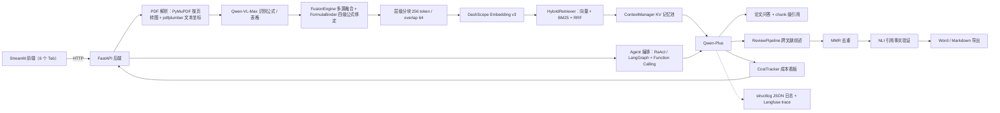

# 多语种文献翻译与论文研读助手

> **API-first、单机可部署的外文论文研读助手**：用云端 VLM + 坐标辅助把公式和正文绑在一起，解决 PDF 公式乱码；用手写的上下文记忆池对抗长文问答的「中间遗忘」；用跨文献 RAG + 引用事实验证生成可溯源的综述初稿。
>
> 个人独立完成的求职项目（4 周敏捷冲刺）。开发机是 8GB 内存的纯 CPU 笔记本，没有独显，所以重模型全部走云端 API，本地只保留业务逻辑与 app + frontend 两服务部署（PG/Redis 用 `--profile full` 可选）——**这套硬件约束下的取舍本身就是项目的一部分**。

---

## 功能

| # | 功能 | 说明 |
|---|------|------|
| 1 | 📄 **PDF 公式无损解析** | PyMuPDF 按页转图 + pdfplumber 抽文本坐标 + Qwen-VL-Max 识别公式/表格，`FusionEngine` 多源融合后由 `FormulaBinder` 做四级规则绑定；输出「正文 + 公式 LaTeX + 表格」与段落的对应关系，低置信绑定标黄提示人工核对 |
| 2 | 🌐 **多语种文献翻译（术语校准）** | `TermGlossary` 在翻译前把专业术语替换成占位符、翻译后还原并强制使用标准译法；翻译走 Qwen-Plus，无 key 时自动降级 Mock 翻译，链路不中断；对应 `POST /translate`（单段 ≤ 5000 字符） |
| 3 | 🤖 **Agent 助手** | LLM 自主调用工具（`list_documents` / `search_chunks` / `translate_text` / `generate_review`），ReAct + LangGraph 编排，前端展示工具调用轨迹（工具名 / 参数 / 结果预览 / 耗时 / 步数 / 成本 / framework）；真实 LLM 工具调用走 DashScope Function Calling，无 key 时使用脚本化 mock LLM |
| 4 | 💬 **基于记忆池的长文问答** | 分块入库时用「正则 + spaCy」抽取数据集/模型/指标/结论等实体写入 KV 池，问答时按问题意图注入 prompt；检索用向量 + BM25 + RRF 混合召回，回答附 chunk 级引用 |
| 5 | 📚 **跨文献综述生成** | 大纲规划 → Map-Reduce 分段生成 → MMR 去重 → NLI 引用事实验证 → 导出 Word（python-docx，参考文献按 GB/T 7714-2015 格式化；python-docx 不可用时降级 Markdown） |

此外还有面向工程治理的**成本看板与可观测性**：每次 LLM/VLM/Embedding 调用记录 `model / tokens / cost / cache`，按天、模型、用户、论文聚合（`GET /cost/summary`，前端「💰 成本看板」Tab）；`structlog` 输出 JSON 结构化日志，配置 Langfuse key 后可回放 LLM 调用链。

---

## 架构



**为什么是 API-first（而不是本地全栈）**：本机 8GB 纯 CPU、无独显，Nougat（需 GPU）、bge-large 系列（约 2GB 显存）、Milvus（带 Etcd + MinIO 吃 4GB+ 内存）都跑不动。因此公式/版面识别用 Qwen-VL-Max、LLM 用 Qwen-Plus、Embedding 用 DashScope text-embedding-v3，本地只保留业务逻辑、记忆池、MMR、正则实体抽取、Agent 编排（LangGraph 纯 Python）和 app + frontend 两服务。**代价是强依赖云端 API（见「已知局限」），收益是这套系统能在一台旧笔记本上真实演示。**

**docker compose：默认两服务 + 可选完整栈**（`docker-compose.yml`）：

| 服务 | 默认 | 镜像 / 构建 | 端口 | 作用 |
|------|------|------------|------|------|
| `app` | ✅ 启动 | 本仓库 `Dockerfile` | 8000 | FastAPI 后端 |
| `frontend` | ✅ 启动 | 复用同一镜像，CMD 换 Streamlit | 8501 | Streamlit 前端，经 `API_BASE_URL=http://app:8000` 访问后端 |
| `db` | ⚠️ 仅 `--profile full` | `pgvector/pgvector:pg16` | 5432 | PostgreSQL 16 + pgvector：**接口预留**（PgvectorRetriever / PgCostTracker 尚未实现，默认内存版） |
| `redis` | ⚠️ 仅 `--profile full` | `redis:7-alpine` | 6379 | 缓存 / 长时记忆池：**接口预留**（未接 Redis 时降级为进程内实现） |

单机单进程部署，不上微服务 / K8s；默认两服务即可演示完整链路（内存版检索 + 成本记录），8GB 机器可运行。需要 PG/Redis 时显式启动：`docker compose --profile full up -d` 或 `make up-full`。

---

## 技术栈

| 类别 | 选型 | 说明 |
|------|------|------|
| 后端 | Python 3.13、FastAPI | 单体应用，`create_app` 应用工厂 + uvicorn 启动 |
| 前端 | Streamlit + `ApiClient` | 6 个 Tab；默认 API 模式（健康检查自动识别），可切换本地进程模式 |
| 向量库 | pgvector（PostgreSQL 扩展，接口预留） | 复用 PG 的设计；当前默认内存版检索（InMemoryVectorRetriever + BM25 + RRF），PgvectorRetriever 未落地 |
| 关系库 | PostgreSQL 16（`--profile full` 可选） | 与向量同库的设计目标；当前元数据在进程内存中，PgCostTracker / 落库为接口预留 |
| 缓存 | 进程内内存（Redis 7 接口预留） | PDF 解析缓存（MD5 + 页码）、问答缓存 |
| PDF 处理 | PyMuPDF、pdfplumber | 转图 + 文本/坐标抽取，纯 CPU |
| 公式 / 版面识别 | Qwen-VL-Max API | 替代本地 Nougat / DocLayout-YOLO |
| Embedding | DashScope text-embedding-v3 | 云端 API |
| LLM | Qwen-Plus（DashScope） | 问答、翻译、综述生成 |
| Agent 编排 | LangGraph 1.2.9 + 手写 ReAct 循环 | `framework=auto/simple/langgraph` 可切换；LangGraph 异常自动回退 simple |
| 工具调用 | DashScope Function Calling（OpenAI tools 格式） | 4 个工具：list_documents / search_chunks / translate_text / generate_review |
| MCP | 手写 stdio JSON-RPC（MCP 2024-11-05） | 零新增依赖，避免 mcp 包把 starlette 升到不兼容版本 |
| Rerank / NLI | DashScope rerank API / Qwen-Plus 零样本 NLI | 引用事实验证；未配置时降级为规则判断 |
| 实体抽取 | 正则规则 + spaCy `en_core_web_sm`（可选） | 纯 CPU，未装 spaCy 时降级纯正则 |
| 导出 | python-docx + GB/T 7714-2015 引用格式 | 无 python-docx 时降级 Markdown |
| 可观测性 | structlog JSON 日志 + Langfuse | 调用链 trace、tokens、成本、延迟 |
| 测试 / CI | pytest、coverage、ruff、mypy、GitHub Actions | push 跑单测与 mock E2E；nightly 跑真实 API 评测 |
| 部署 | Docker Compose（默认 2 服务） | `make up` 起 app + frontend；PG/Redis 用 `make up-full`（`--profile full`）可选 |

---

## 快速开始

### 环境要求

- **Python 3.13**（实测 3.13.0；`requirements.txt` 声明支持 >= 3.11）
- 可选：**Docker + Docker Compose**（仅容器化演示需要）
- 可选：**DASHSCOPE_API_KEY + 网络**（真实模型调用需要；不填则自动 mock 模式，全链路和测试仍可跑）
- 命令以 **Windows PowerShell** 为主，Linux / macOS 使用文中的 make 等价命令

### 1. 安装依赖

Windows（PowerShell，项目根目录执行）：

```powershell
cd paper-research-assistant
python -m venv .venv
.\.venv\Scripts\python.exe -m pip install --upgrade pip
# 优先用锁文件精确复现（含 fastapi / streamlit / plotly 等前端依赖）
.\.venv\Scripts\python.exe -m pip install -r requirements.lock
# 需要跑测试 / 覆盖率 / lint 时，再装开发依赖：
.\.venv\Scripts\python.exe -m pip install -r requirements-dev.txt
```

Linux / macOS：

```bash
cd paper-research-assistant
python3 -m venv .venv
source .venv/bin/activate
pip install --upgrade pip
pip install -r requirements.lock
pip install -r requirements-dev.txt   # 可选：测试 / 覆盖率 / lint
```

> **推荐用 `requirements.lock` 安装**：直接依赖精确 pin（与验证环境一致），且已包含前端 `streamlit==1.50.0` / `plotly==7.1.0` 与 Agent 编排 `langgraph==1.2.9` / `langchain-core==1.5.5`，装完即可启动前后端、Agent 与 MCP。
> 如需宽松的版本声明用 `requirements.txt`；其中 streamlit 约束为 `streamlit>=1.37,<1.51`——**streamlit 1.51+ 依赖 starlette>=0.46，会与锁定的 `fastapi==0.110.0` / `starlette==0.36.3` 冲突，升级 streamlit 必须同步升级 fastapi / starlette / httpx**。不要单独安装未锁定版本的 streamlit（可能拉到 1.51+ 破坏环境）。
> 也可以直接执行 `.\scripts\dev.ps1 install`（自动使用 `.venv`，优先安装 `requirements.lock`，再安装开发依赖）。

### 2. 配置 API Key

Windows：

```powershell
Copy-Item .env.example .env
notepad .env   # 填入 DASHSCOPE_API_KEY=sk-xxxxxxxx
```

Linux / macOS：

```bash
cp .env.example .env
${EDITOR:-vi} .env   # 填入 DASHSCOPE_API_KEY=sk-xxxxxxxx
```

- **不填 key 也可以启动**：应用自动进入 mock 模式，LLM/VLM/Embedding 走模板化实现，`GET /health` 返回 `mock_mode=true`。
- 前端侧边栏也支持临时输入 key（仅本地进程模式生效），但推荐统一放在 `.env`（`.gitignore` 已忽略，不会入库）。

### 3. 启动后端与前端（Windows PowerShell）

```powershell
# 后端 FastAPI：http://127.0.0.1:8000（Swagger 接口文档在 /docs）
.\scripts\dev.ps1 api

# 另开一个终端，启动前端 Streamlit：http://127.0.0.1:8501
.\scripts\dev.ps1 frontend
```

`scripts/dev.ps1` 是 Windows 原生的开发脚本（无需安装 GNU make），会自动优先使用 `.venv\Scripts\python.exe`，并设置 `PYTHONIOENCODING=utf-8` 避免 Windows 控制台/管道下的中文乱码。可用动作：

```powershell
.\scripts\dev.ps1 install            # 安装运行依赖 + 开发依赖
.\scripts\dev.ps1 api                # 启动 FastAPI 后端
.\scripts\dev.ps1 frontend           # 启动 Streamlit 前端
.\scripts\dev.ps1 test               # 5 个 verify 脚本 + E2E mock + 补齐模块验证 + Agent 链路验证
.\scripts\dev.ps1 test-pytest        # pytest 回归测试
.\scripts\dev.ps1 coverage           # 覆盖率报告 + 核心模块 >= 85% 门控
.\scripts\dev.ps1 e2e-mock           # 全链路 mock E2E
.\scripts\dev.ps1 eval               # 评测 quick 模式（mock，无需 key）
.\scripts\dev.ps1 eval -EvalMode nightly   # 真实 DashScope 评测（需 key）
.\scripts\dev.ps1 verify-completion  # 翻译 / GB/T 7714 / 论文结构拆解验证
.\scripts\dev.ps1 verify-agent       # Agent 链路验证（工具 / ReAct / LangGraph / 边界，mock）
.\scripts\dev.ps1 agent-eval         # Agent 评测 mock（任务成功率 / 工具选择 / 步数 / 成本）
.\scripts\dev.ps1 mcp-smoke          # MCP stdio 协议冒烟（tools/call 需先启动后端）
.\scripts\dev.ps1 all                # test + test-pytest + e2e-mock + eval + verify-completion
```

> 若 PowerShell 提示禁止运行脚本，可只对当前终端放宽策略：
> `Set-ExecutionPolicy -Scope Process -ExecutionPolicy Bypass`

**不依赖 dev.ps1 的等价手动命令**（同样是两个终端）：

```powershell
# 终端 1：后端
.\.venv\Scripts\python.exe -m uvicorn app.api.routes:create_app --factory --host 127.0.0.1 --port 8000 --reload

# 终端 2：前端
.\.venv\Scripts\python.exe -m streamlit run app/frontend/streamlit_app.py --server.port 8501
```

> 注意：FastAPI 自动生成的 Swagger UI 在 `/docs`（ReDoc 在 `/redoc`）；本项目自己的「已索引文档列表」业务接口是 `GET /documents`，两者不要混淆。

### 4. 启动（Linux / macOS，make）

```bash
source .venv/bin/activate
make api          # 后端；另开终端 make frontend 启动前端
make test         # verify 脚本套件（含 verify-completion / verify-agent）
make test-pytest  # pytest 回归
make e2e-mock     # 全链路 mock E2E
make eval         # 评测（默认 quick / mock）
make coverage && make coverage-check   # 覆盖率 + 核心模块门槛校验
make verify-agent # Agent 链路验证（mock）
make agent-eval   # Agent 评测（mock）
make mcp-smoke    # MCP stdio 协议冒烟（tools/call 需先 make api 启动后端）
make up           # docker compose 默认两服务（app + frontend）
make up-full      # 额外启动 PG(pgvector) + Redis（--profile full，当前接口预留）
make down         # 停止容器
```

### 5. Docker Compose 一键启动（可选）

```powershell
docker compose up -d                          # 默认两服务：app + frontend（或 make up）
docker compose --profile full up -d           # 可选：额外启动 PG(pgvector) + Redis（或 make up-full）
docker compose logs -f app                    # 或 make logs
docker compose down                           # 或 make down
```

启动后访问 `http://127.0.0.1:8501`。容器内前端通过 `API_BASE_URL=http://app:8000` 访问后端，无需额外配置；镜像首次构建需要网络，之后启动较快。**前提是本机已安装并启动 Docker Desktop。** 默认堆栈即可演示完整链路；`--profile full` 的 PG/Redis 当前为**接口预留**（PgvectorRetriever / PgCostTracker 未实现），默认使用进程内内存版。

### 6. 前端两种运行模式

前端（`app/frontend/streamlit_app.py` + `app/frontend/api_client.py`）支持两种模式，侧边栏「🔌 运行模式」可随时切换：

| 模式 | 触发方式 | 说明 |
|------|---------|------|
| **🌐 API 模式（默认）** | 首次加载时 `ApiClient` 探测 `GET {API_BASE_URL}/health`（3 秒连接超时），可达即为默认模式 | 前端通过 HTTP 调用 FastAPI：上传、翻译、Agent、问答、综述、成本数据全部走后端接口，前后端解耦、可分别部署 |
| **💻 本地进程模式** | 后端不可达时默认进入；或点击侧边栏「一键切换到本地进程模式」 | Streamlit 进程内直接调用 `app.*` 模块（Agent 用 in-process `AgentRunner`），**无需先启动后端**；适合只体验前端或排查后端问题 |

- **API 模式下 Key 由后端进程读取**（`.env` / 环境变量）；本地进程模式可在侧边栏临时输入，仅保存在当前会话。
- API 模式下后端不可达时，页面会给出启动后端提示和「一键切换到本地进程模式」按钮，不会白屏。
- `API_BASE_URL` 默认值为 `http://127.0.0.1:8000`，docker-compose 下由环境变量注入 `http://app:8000`。手动覆盖示例：

```powershell
$env:API_BASE_URL = 'http://127.0.0.1:8000'
.\scripts\dev.ps1 frontend
```

```bash
API_BASE_URL=http://127.0.0.1:8000 make frontend
```

前端 Tab 顺序固定为：**📄 PDF 上传 / 🌐 文献翻译 / 🤖 Agent 助手 / 💬 论文问答 / 📚 综述生成 / 💰 成本看板**。

---

## API 端点

后端为 FastAPI 单体（Mock 模式下同样可用，便于前端联调）。启动后可用 `GET /health` 自检；Swagger UI 在 `http://127.0.0.1:8000/docs`（ReDoc 在 `/redoc`）。已索引文档可通过 `GET /documents` 查询（提交综述时传入 `doc_ids`）。

| 方法 | 路径 | 请求要点 | 用途 / 关键响应字段 |
|------|------|---------|-------------------|
| GET | `/health` | 无 | 健康检查；`status`、`version`、`mock_mode`、`components`（含 parser / rag / review / llm / translation / agent）；前端据此判断 API 模式是否可用 |
| POST | `/upload` | JSON：`filename`、`file_b64`（base64 PDF）、`user_id`、`use_vlm`（可选，默认 `false` 走文本层；`true` 走 VLM 链路，最多前 10 页） | 解析 PDF、分块并建立进程内文档索引；响应 `doc_id`、`paper_id`、`title`、`num_pages`、`num_chunks`、`formula_resolved`、`need_review`、`chunks`（分块预览）、`vlm_used`、`formulas`（公式预览）、`parse_mode`（text / vlm / text_fallback） |
| POST | `/translate` | JSON：`text`（≤ 5000 字符）、`source_lang`（默认 `en`）、`target_lang`（默认 `zh-CN`）、`user_id` | 单段翻译 + 术语校准；响应 `translated`、`source_text`、`aligned_terms`、`target_lang`、`mock_mode`、`latency_ms` |
| POST | `/agent` | JSON：`question`（≤ 2000 字）、`doc_id`、`user_id`、`max_steps`（默认 6，上限 8）、`framework`（`auto` / `simple` / `langgraph`）、`history` | LLM 自主调用工具完成研读任务；响应 `answer`、`steps`、`tool_calls`、`citations`、`model`、`input_tokens`、`output_tokens`、`cost_yuan`、`mock_mode`、`framework`、`latency_ms` |
| GET | `/agent/tools` | 无 | 列出 Agent 可用工具（OpenAI tools 格式，供 MCP server / 前端展示） |
| POST | `/agent/tools/call` | JSON：`name`、`arguments` | 直接调用单个 Agent 工具（供 MCP 适配器 / 调试）；响应 `name`、`arguments`、`result`、`error`、`latency_ms` |
| POST | `/ask` | JSON：`paper_id`、`question`（≤ 2000 字）、`user_id`、`use_memory`、`top_k`、`history`（最近几轮问答） | 记忆池增强的 RAG 问答；响应 `answer`、`citations`、`model`、`input_tokens`、`output_tokens`、`cost_yuan`、`mock_mode`、`memory_used`、`from_cache`、`latency_ms` |
| POST | `/review` | JSON：`topic`（≤ 500 字）、`doc_ids`、`num_sections`、`verify_citations`、`export_docx` | 跨文献综述 + 引用事实验证；响应 `title`、`full_text`、`outline`、`paragraphs`、`citation_stats`、`references`、`verified`；`export_docx=true` 时在内存中渲染并返回 `docx_b64`、`docx_mode`（docx / markdown）、`docx_name`、`docx_size` |
| GET | `/documents` | 无 | 已完成索引的文档列表；响应 `docs: [{doc_id, title, num_chunks}]` |
| GET | `/cost/summary` | 无 | 成本看板聚合；响应 `total_cost`、`daily`、`by_model`、`by_user`、`by_paper`、`cache`（命中率 / 命中数 / 总调用） |

> 输入限制：单 PDF ≤ 50MB、页数 ≤ 200（VLM 链路最多前 10 页）；提问 / Agent 提问 ≤ 2000 字；综述主题 ≤ 500 字；单次翻译 ≤ 5000 字符（见 `app/api/routes.py` 常量，违反时响应的 `error` 字段会说明原因）。

---

## 测试与验证

所有离线测试默认 **mock 隔离**：清空 API key 后运行，不产生费用。Windows 下用 `.venv` 的 Python 直接跑脚本时，建议先设置 `$env:PYTHONIOENCODING='utf-8'`（`dev.ps1` 会自动设置），避免 ✓ 等字符在 GBK 控制台报编码错误。

### 数据口径与可复现性声明（重要）

仓库内指标分三档口径，**面试 / 评审引用时请勿混用**（项目文档 §0.2 有完整表格）：

| 口径 | 内容 | 能否仓库内复现 |
|------|------|----------------|
| **① 仓库内可复现（mock，无 key）** | pytest 回归（P1 基线 28 passed + Agent/MCP 新增用例，总数以实际运行输出为准）、5 个模块级 verify 脚本、`verify_completion_modules.py --mock`、`verify_agent_pipeline.py`、`run_agent_eval.py --mode mock`、E2E mock、`verify_pain_points.py`、覆盖率门控（95.0% / 94.9% / 86.8%） | ✅ 推荐引用 |
| **② 真实 API 实测（需 key + 网络）** | `scripts/demo_real_paper.py`（15 页 / 107 chunks）、`scripts/demo_uploaded_papers.py`（28 篇 arXiv / 917 页 / 7,726 chunks，0 失败）、单问成本约 0.003–0.004 元 | 有 key 时可复现 |
| **③ 历史实验 / 设计目标（†）** | 公式乱码率 40%→5%、Rouge-L 0.62→0.81、QA 准确率 81%（基线 62%）、10 篇 CVPR 平均 50 秒/篇、单篇成本 2.4 元、200 篇 QA 数据集、MMR 重复 4.2→0.8 处、NLI 200 条样本 71%、缓存命中率约 60% / 30% 等 | ❌ 非仓库内可复现，仅面试讲解用 |

> **评测口径提醒**：`python tests/eval/run_eval.py --mode quick` 是 **mock 口径**，本机实测 Rouge-L≈0.05、Composite≈0.103（mock 回答不含真实语义，只用于链路与数值解析回归），**不可与历史 0.81 直接比较**；`--mode nightly` 才需真实 key。历史数字来自早期不同数据集 / 真实 API 环境，详见项目文档 §0.2。

### Windows PowerShell（复制即用）

```powershell
$env:PYTHONIOENCODING = 'utf-8'
$py = ".\.venv\Scripts\python.exe"

# 1) pytest 回归（pyproject 只收集 tests/unit/test_*.py）
& $py -m pytest -v

# 2) 五个模块级 verify 脚本
& $py tests/unit/verify_context_manager.py
& $py tests/unit/verify_rag_pipeline.py
& $py tests/unit/verify_review_pipeline.py
& $py tests/unit/verify_parser_pipeline.py
& $py tests/unit/verify_infrastructure.py

# 3) 补齐模块验证（翻译 / GB/T 7714 引用 / 论文框架拆解），--mock 强制离线
& $py tests/unit/verify_completion_modules.py --mock

# 4) Agent 链路 / Agent 评测 / MCP 协议冒烟（全 mock，无 key）
& $py tests/unit/verify_agent_pipeline.py
& $py tests/eval/run_agent_eval.py --mode mock --output report_agent.json
& $py scripts/agent_mcp_smoke.py    # tools/list 协议帧；--call 需先启动后端

# 5) 全链路 mock E2E 与三大痛点闭环验证
& $py tests/e2e/test_e2e_mock.py
& $py scripts/verify_pain_points.py

# 6) 评测 quick 模式（mock，无 key；本机实测约 3 秒）
& $py tests/eval/run_eval.py --mode quick --output report_quick.json
```

> 也可以直接用脚本一键执行：`.\scripts\dev.ps1 test`（verify + E2E mock + 补齐模块 + Agent 验证）、`.\scripts\dev.ps1 test-pytest`、`.\scripts\dev.ps1 coverage`、`.\scripts\dev.ps1 eval`、`.\scripts\dev.ps1 verify-agent`、`.\scripts\dev.ps1 agent-eval`、`.\scripts\dev.ps1 mcp-smoke`、`.\scripts\dev.ps1 all`。

### Linux / macOS（复制即用）

```bash
source .venv/bin/activate

python -m pytest -v

python tests/unit/verify_context_manager.py
python tests/unit/verify_rag_pipeline.py
python tests/unit/verify_review_pipeline.py
python tests/unit/verify_parser_pipeline.py
python tests/unit/verify_infrastructure.py

python tests/unit/verify_completion_modules.py --mock
python tests/unit/verify_agent_pipeline.py
python tests/eval/run_agent_eval.py --mode mock --output report_agent.json
python scripts/agent_mcp_smoke.py
python tests/e2e/test_e2e_mock.py
python scripts/verify_pain_points.py

python tests/eval/run_eval.py --mode quick --output report_quick.json

# 覆盖率门控（核心 3 模块 >= 85%）
make coverage && make coverage-check
```

### 本机实测结果（mock 模式）

| 项 | 结果 |
|----|------|
| `pytest` 回归 | **74 passed / 0 failed**（mock 隔离、无需 key；含 P1 基线 28 + Agent 回归 20 + API Agent 16 + MCP 10） |
| 5 个模块 verify 脚本 | 全部通过 |
| `verify_completion_modules.py --mock` | 通过（28 项检查） |
| `verify_agent_pipeline.py` | 通过（66/66 断言：工具注册 / ReAct / LangGraph / 边界恢复） |
| `run_agent_eval.py --mode mock` | 通过：6/6 任务，task success 100%，tool selection 100%，avg_steps 2.17，成本 ¥0 |
| `agent_mcp_smoke.py` | 通过：initialize（protocolVersion 2024-11-05）/ tools/list 4 工具；`--call` 需先启动后端 |
| `tests/e2e/test_e2e_mock.py` | 通过（全链路 mock，约 2 秒） |
| `scripts/verify_pain_points.py` | 三大痛点全部闭环 |
| `tests/eval/run_eval.py --mode quick` | 通过，输出 JSON 报告（本机约 3 秒；quick mock 口径 Rouge-L≈0.05，不可与历史 0.81 比较） |

### 覆盖率门控

`make coverage && make coverage-check`（Windows 可用 `.\scripts\dev.ps1 coverage`）会合并 5 个 verify 脚本与 pytest 的覆盖率数据，再由 `scripts/check_coverage.py` 校验核心模块门槛（≥ 85%）。验证报告中的实测值：

| 核心模块 | 实测覆盖率 | 门槛 |
|---------|-----------|------|
| `app/rag/context_manager.py` | 95.0% | ≥ 85% |
| `app/parser/fusion_engine.py` | 94.9% | ≥ 85% |
| `app/review/citation_verifier.py` | 86.8% | ≥ 85% |

### 真实模型验证（需 key + 网络，可选）

```powershell
$env:PYTHONIOENCODING = 'utf-8'
.\.venv\Scripts\python.exe scripts\demo_real_paper.py
.\.venv\Scripts\python.exe scripts\demo_uploaded_papers.py --paper deepseek --limit 1
.\.venv\Scripts\python.exe tests\eval\run_eval.py --mode nightly --output report.json
.\.venv\Scripts\python.exe tests\eval\run_agent_eval.py --mode real --limit 2   # 可选：Agent 真实工具调用，需 key 与小额费用
```

```bash
python scripts/demo_real_paper.py
python scripts/demo_uploaded_papers.py --paper deepseek --limit 1
python tests/eval/run_eval.py --mode nightly --output report.json
python tests/eval/run_agent_eval.py --mode real --limit 2   # 可选：Agent 真实工具调用，需 key 与小额费用
```

> Agent 真实评测（`--mode real`）会产生真实 DashScope 费用，默认不跑；mock 模式（`--mode mock`）可离线验证编排与指标结构。

> 已实测（见 [VERIFICATION_REPORT.md](VERIFICATION_REPORT.md) §5）：`sample_papers/` 中 28 篇真实 arXiv 论文批量解析 28/28 成功（917 页 / 7726 chunks）；Attention、DeepSeek-V3 等论文的真实 Embedding + Qwen-Plus 问答链路可用，单问成本约 0.003–0.004 元。

### CI（GitHub Actions）

- **push / pull_request**：`unit-tests` job 按 `requirements.lock` 安装依赖，执行语法编译、pytest、5 个 verify 脚本、`verify_completion_modules.py --mock`、`verify_agent_pipeline.py`、`run_agent_eval.py --mode mock` 和 E2E mock（mock 模式，无需 key）。
- **nightly（UTC 02:00，约北京时间 10:00）**：`nightly-eval` job 使用 Secrets 中的 `DASHSCOPE_API_KEY` 跑真实 DashScope 评测与覆盖率门控，并上传 `report.json` 作为构建产物。

---

## 目录结构

```text
paper-research-assistant/
├── app/
│   ├── agent/            # Agent 核心：工具注册 / ReAct + LangGraph 编排 / Function Calling LLM
│   ├── api/              # FastAPI 路由（/health /upload /translate /ask /review /agent /documents /cost/summary）
│   ├── common/           # 公共数据结构（PaperMeta 等）
│   ├── export/           # Word 导出（python-docx + GB/T 7714 参考文献）
│   ├── frontend/         # Streamlit 前端：api_client.py + 6 Tab 页面
│   ├── llm/              # LLM 调用封装（重试 / 缓存 / 部分结果降级）
│   ├── observability/    # CostTracker 成本追踪、structlog 日志、Langfuse 埋点
│   ├── parser/           # PDF 解析：VLM 客户端 / 文本坐标 / 融合 / 公式绑定 / 表格降级
│   ├── rag/              # 分块 / Embedding / 混合检索 / ContextManager / MMR / 实体抽取
│   ├── review/           # 综述生成 / 引用事实验证 / 大纲规划 / GB/T 7714 格式化
│   └── translation/      # 多语种翻译 + 术语词库
├── tests/
│   ├── unit/             # pytest 回归（test_*.py）+ 模块级 verify_*.py 验证脚本
│   ├── e2e/              # 全链路 E2E（mock / DashScope 真实两套）
│   ├── eval/             # 评测脚本（Rouge-L / 引用 F1 / 公式乱码率 / Agent 任务指标）
│   └── qa_dataset/       # 内置样例 QA 数据集 + 数据构建脚本
├── scripts/              # dev.ps1、agent_mcp_server.py、agent_mcp_smoke.py、覆盖率门控、演示/验证脚本
├── sample_papers/        # 真实 arXiv PDF（版权文件不入 git，演示脚本按需下载）
├── .github/workflows/    # CI：push 单测 + nightly 真实评测
├── docker-compose.yml    # 默认 app + frontend 两服务；PG(pgvector)/Redis 用 --profile full 可选
├── Dockerfile            # Python 3.13-slim 镜像
├── Makefile              # Linux / macOS / WSL 的开发与验证入口
├── .env.example          # 环境变量模板
├── requirements.txt      # 运行时依赖声明
├── requirements.lock     # 直接依赖精确版本（可复现安装，含 Agent 依赖）
├── requirements-dev.txt  # 测试 / 覆盖率 / lint 依赖
├── pyproject.toml        # pytest / coverage / ruff / mypy 配置
├── VERIFICATION_REPORT.md
└── README.md
```

---

## 核心设计

1. **公式绑定用「规则为主、坐标辅助」，不做假 IoU**：Qwen-VL-Max 只返回自然语言位置描述而不返回精确坐标框，所以 `FormulaBinder` 按四级规则绑定——段落序号匹配（置信度 0.9）→ 位置描述映射（0.7）→ 文本锚点匹配（0.5）→ 未绑定（0.3，`need_review=true`）。低于 0.7 的绑定前端黄色高亮，提示人工复核，而不是假装准确。
2. **手写 ContextManager KV 记忆池**：不用 LangChain 的 Memory（BufferMemory 无限增长、SummaryMemory 丢实体），改为在分块入库阶段用正则 + spaCy 抽取数据集/模型/指标/结论四类实体写入 KV 池，问答时按问题意图筛选并注入 prompt；超过容量按 LRU 淘汰，每条实体保留来源 chunk 便于溯源。
3. **MMR 去重**：综述 Reduce 阶段选片段时同时考虑与主题的相关性和与已选片段的冗余度（`lambda_=0.7`），抑制多篇文献观点雷同导致的「车轱辘话」。
4. **NLI 引用事实验证**：LLM 生成综述时强制输出 `[doc_id, chunk_id]` 引用，生成后按 chunk_id 回查原文并用 NLI 判定 entailment / contradiction / neutral；矛盾引用标红提示人工复核，引用不是「写上去就算数」。
5. **成本治理与降级链**：解析结果按 PDF MD5 + 页码缓存（TTL 30 天）、问答级缓存命中不计费；LLM/VLM 调用失败先指数退避重试，仍失败则回退 pdfplumber 纯文本（标注 `formula_resolved=false`）或返回已生成的缓存段落（partial），做到「部分结果好过无结果」。
6. **API-first 前后端解耦**：所有能力先收敛为 FastAPI 接口，Streamlit 通过 `ApiClient` 调用；后端不可达时前端默认进入本地进程模式（也可一键切换）继续演示。容器与本地两种运行方式共用同一套接口契约。
7. **Agent 编排 + Function Calling + MCP 工具服务**：把检索/翻译/综述能力注册为 4 个工具（`list_documents` / `search_chunks` / `translate_text` / `generate_review`），LLM 通过 Function Calling 自主决策调用；提供 `simple` ReAct 循环与 LangGraph 图编排两套实现（异常自动回退 simple），结果结构统一为 `AgentResult`；另附手写 stdio JSON-RPC 的 MCP server，把工具暴露给任意 MCP 客户端。mock 模式下用脚本化 LLM 演示完整工具调用轨迹，真实调用走 DashScope tools。

---

## 已知局限

诚实交代边界，都是当前版本真实存在、而非「未来会做」的优化点：

- **复杂嵌套表格还原有限**：跨行跨列合并表头的表格，VLM 还原为 Markdown 的准确率有限；置信度低时裁剪表格图片送 VLM 二次验证，仍可能误读（验证过程出现过 `mAP@0.5` 被读成 `mAP@0.15` 的案例，已加入回归集）。
- **综述风格偏「文献罗列」**：生成结果缺少批判性观点提炼，项目定位是「文献整理助手」，最终学术判断仍需人工。
- **强依赖云端 API**：网络抖动或服务商故障会影响可用性；已做重试、降级、缓存，但**未做多服务商容灾**（如 Qwen 不可用时切 GPT）。
- **单进程文档索引**：`/upload` 建立的文档索引保存在进程内存中，重启后丢失，多 worker 部署也不共享；生产化需要接入 pgvector / PG（接口已预留）。
- **VLM 真实公式/版面识别需真实 key 与网络**：自动化测试以文本层链路 + mock 为主，真实 VLM 按页识别仅在配置 key 的演示中验证。
- **pgvector / Redis / PG 成本追踪为接口预留或内存版**：docker-compose 默认只启动 app + frontend，PG/Redis 需 `--profile full`；当前检索与成本追踪默认走进程内内存实现（`PgvectorRetriever` / `PgCostTracker` 未落地），落地需数据库服务就位。
- **Agent 为 mock 可演示、真实调用需费用**：mock 模式可完整演示工具调用轨迹；真实 LLM 自主工具调用需要 key 与少量 API 费用，工具选择质量依赖模型能力。
- **MCP 为最小协议实现**：手写 stdio JSON-RPC 支持 `initialize` / `tools/list` / `tools/call`，不是完整 MCP 生态实现；`tools/call` 依赖后端已启动并持有文档索引。
- **评测集规模有限**：内置 3 篇样例 QA，扩展到更大规模需 `make dataset` + DashScope 真实调用；成本随用量线性增长。
- **Docker 演示需要本机安装 Docker**：无 Docker 时使用 `dev.ps1` / `make` 的本地进程方式运行。

---

## 文档

- [项目文档：定位、架构、技术选型、开发计划与已知局限](../项目8-多语种文献翻译与论文研读助手-项目文档.md)
- [验证报告：实测数据、测试矩阵、真实论文演示与缺陷修复记录](VERIFICATION_REPORT.md)
