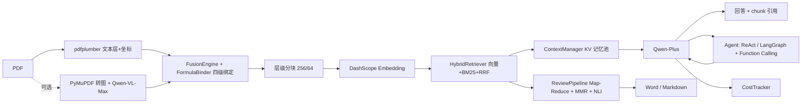

# 多语种文献翻译与论文研读助手 [](https://github.com/lz204/paper-research-assistant/actions/workflows/ci.yml)

> **API-first 的论文研读助手**：把 PDF 公式与正文绑在一起解决公式乱码，用手写 KV 记忆池对抗长文「中间遗忘」，用跨文献 RAG + 引用事实验证生成可溯源的综述初稿。
>
> **项目形态**：个人求职项目（原型阶段，本地运行，未部署、无真实用户）。本人负责方案设计、核心实现、测试与调试验收；开发中使用 AI 编码助手加速，代码逐模块阅读/修改并跑回归验证。
>
> **运行环境**：11.8GB 物理内存 / 8GB 级可用的纯 CPU 笔记本（无独显）+ 云端 DashScope API；本地进程方式实测可运行。
>
> **数据口径**：① 仓库内可复现（mock，无需 key）/ ② 真实 API 单次实测（需 `DASHSCOPE_API_KEY`）/ ③ 历史实验†（仅见项目文档附录 B）。简历与面试口播只引用 ①、②。

---

## 可演示亮点（3 个）

1. **公式不丢上下文**：默认文本层 + 可选 Qwen-VL（≤10 页）+ FusionEngine 融合 + FormulaBinder 四级绑定，低置信标黄；可现场演示 PDF →「正文 + LaTeX 公式 + 表格」与落点段落。
2. **长文不遗忘**：手写 `ContextManager` KV 记忆池（入库抽实体、问答按意图注入），`/ask` 返回 `memory_used` / `memory_entities`（主）/ `memory_items`（同值别名）可观测。
3. **综述可溯源**：Map-Reduce + MMR + NLI 引用事实验证；`/review` 返回 `citation_stats` / `generator_mode` / `mmr_enabled` / `mmr_applied` / `verification_skipped` / `verification_skip_reason`，引用三色标记。

> 另：Agent 助手（Function Calling + LangGraph + 手写 MCP 工具链）在前端第 6 Tab 可看工具轨迹。

## 功能

| # | 能力 | 说明 |
| --- | --- | --- |
| 1 | 📄 **PDF 公式解析与绑定** | 默认 pdfplumber 文本层 + 坐标；可选 VLM 链路（Qwen-VL-Max，每次最多前 10 页）；FusionEngine 融合 + FormulaBinder 四级绑定，低置信标黄提示人工核对 |
| 2 | 💬 **记忆池长文问答** | 入库时抽取数据集/模型/指标/结论写入 KV 池，问答按意图注入；向量 + BM25 + RRF 混合检索；回答带 chunk 级引用 |
| 3 | 📚 **跨文献综述** | 大纲规划 → Map-Reduce → MMR 去重 → NLI 引用事实验证 → Word 导出（GB/T 7714-2015） |
| 4 | 🌐 **多语种翻译（术语校准）** | 术语占位符保护 + 标准译法强制还原；无 key 时 Mock 翻译降级，链路不中断 |
| 5 | 🤖 **Agent 助手** | 4 工具 Function Calling；simple ReAct / LangGraph 双实现（异常自动回退）；前端展示工具轨迹；手写 MCP stdio server（`tools/call` 转发后端工具注册表） |

工程治理：CostTracker 成本看板（`GET /cost/summary`）、structlog JSON 日志（未装则标准 logging）、Langfuse 调用链（未配置则 mock）、重试与降级链。

## 架构



**为什么 API-first**：本机无 GPU，Nougat（需 GPU）、bge-large（约 2GB 显存）、Milvus（Etcd + MinIO 吃 4GB+ 内存）都跑不动；因此公式识别、Embedding、LLM 走云端 API，本地只保留业务逻辑、记忆池、MMR、正则抽取与 Agent 编排（LangGraph 纯 Python）。代价是强依赖网络（见「已知限制」）。

## 技术栈

| 类别 | 选型 |
| --- | --- |
| 后端 / 前端 | Python 3.13 + FastAPI（单体）/ Streamlit（6 Tab，默认 API 模式） |
| PDF / 向量 | PyMuPDF、pdfplumber 0.11.9（已锁定）；进程内 InMemory 索引 + BM25 + RRF（pgvector 接口预留） |
| LLM / Embedding | Qwen-Plus、DashScope text-embedding-v3 |
| Agent / MCP | LangGraph 1.2.9 + 手写 ReAct；DashScope Function Calling；手写 stdio JSON-RPC |
| 数据 / 导出 | PostgreSQL 16 / pgvector / Redis 均接口预留；python-docx + GB/T 7714-2015 |
| 可选增强 | spaCy `en_core_web_sm`、structlog、Langfuse（未装时分别降级纯正则 / 标准 logging / mock） |
| 测试 / CI | pytest（92 项）、coverage（pytest 门禁 55% + 核心模块门控 85%）、ruff（基础正确性）、GitHub Actions（push 单测/覆盖率/ruff + docker-build 非阻断 + nightly 真实评测） |

## 快速开始

```powershell
python -m venv .venv
.\.venv\Scripts\python.exe -m pip install -r requirements.lock -r requirements-dev.txt
Copy-Item .env.example .env              # 填 DASHSCOPE_API_KEY；不填自动 mock
.\scripts\dev.ps1 api                    # 1) FastAPI http://127.0.0.1:8000（Swagger: /docs）
.\scripts\dev.ps1 frontend               # 2) Streamlit http://127.0.0.1:8501
.\scripts\dev.ps1 test-pytest            # 3) 验证（mock，无费用；Linux/macOS 用 make init/api/frontend/test-pytest）
```

- `requirements.lock` 已锁 `streamlit==1.50.0` / `plotly==7.1.0` / `langgraph==1.2.9` / `langchain-core==1.5.5`；不要单独装 streamlit 1.51+（会与 `fastapi==0.110.0` / `starlette==0.36.3` 冲突）。
- 不填 key 也能启动：LLM / VLM / Embedding 走 mock，`GET /health` 返回 `mock_mode=true`；**Docker** 已编写 `Dockerfile` / `docker-compose.yml`，GitHub Actions 的 `docker-build` job 已通过 `docker build` + `docker compose config`（未实机部署、未跑容器），本地运行以 `dev.ps1` / `make` 为准。

## API 端点

| 方法 | 路径 | 用途 / 关键响应字段 |
| --- | --- | --- |
| GET | `/health` | `status` / `mock_mode` / `components`（含 parser、rag、review、llm、translation、agent） |
| POST | `/upload` | 解析 PDF 并建索引；`doc_id`、`num_pages`、`num_chunks`、`chunks`、`vlm_used`、`formulas`、`parse_mode`（text / vlm / text_fallback） |
| POST | `/translate` | 单段翻译（≤5000 字符）；`translated`、`aligned_terms` |
| POST | `/ask` | 记忆池问答；`answer`、`citations`、`memory_used`、`memory_entities`（主）、`memory_items`（同值别名）、`from_cache`、`cost_yuan` |
| POST | `/review` | 综述 + 引用验证；`full_text`、`citation_stats`、`verified`、`generator_mode`、`mmr_enabled`、`mmr_applied`、`dedup_stats`、`verification_skipped`、`verification_skip_reason`、`verification_error`（同值别名）、`docx_b64` |
| POST | `/agent` | Agent 任务；`answer`、`steps`、`tool_calls`、`framework`、`cost_yuan` |
| GET | `/agent/tools`；POST `/agent/tools/call` | 工具列表（OpenAI tools 格式）；单工具调试 / MCP 适配 |
| GET | `/documents`；GET `/cost/summary` | 已索引文档列表；成本看板聚合 |

输入限制：单 PDF ≤50MB、页数 ≤200（VLM 链路最多前 10 页）；提问 / Agent ≤2000 字；综述主题 ≤500 字；`max_steps` 默认 6、上限 8。

## 测试与验证

以下命令均为 **mock 隔离、无需 key、不产生费用**（Windows 建议先设 `$env:PYTHONIOENCODING='utf-8'`）：

```powershell
$py = ".\.venv\Scripts\python.exe"
& $py -m pytest -v                                # pytest 回归（mock；92 passed / 0 failed / 0 skipped）
foreach ($f in "context_manager","rag_pipeline","review_pipeline","parser_pipeline","infrastructure") { & $py "tests/unit/verify_$f.py" }
& $py tests/unit/verify_completion_modules.py --mock   # 翻译 / 引用格式 / 结构拆解（28 项）
& $py tests/unit/verify_agent_pipeline.py              # Agent 链路（66/66 断言）
& $py tests/eval/run_agent_eval.py --mode mock --output report_agent.json
& $py scripts/agent_mcp_smoke.py                       # MCP stdio 协议冒烟
& $py tests/e2e/test_e2e_mock.py                       # 全链路 mock E2E
& $py scripts/verify_pain_points.py                    # 三大痛点闭环
& $py tests/eval/run_eval.py --mode quick               # 评测 quick（mock 口径）
```

Linux / macOS：`make test`、`make test-pytest`、`make e2e-mock`、`make eval`、`make coverage && make coverage-check`；也可用 `.\scripts\dev.ps1 test` 一键执行。

| 本机实测（mock 模式） | 结果 |
| --- | --- |
| pytest 回归 | **92 passed / 0 failed / 0 skipped**（74 基线 + 12 记忆池/MMR/NLI + 6 项 P0 接线回归） |
| 5 个模块 verify + 补齐模块验证 | 全部通过（28/28 项检查） |
| Agent 链路 / mock 评测 / MCP 冒烟 | 66/66 断言；6/6 任务，success 100%、tool selection 100%、avg 2.17 步、¥0；initialize + 4 工具 |
| E2E mock / 三大痛点 | 全部通过 |
| API mock 全链路（10 端点） | 10/10 HTTP 200；/ask `memory_used=true, memory_entities=2, memory_items=2`（use_memory=false 全 0）；/review `generator_mode=mock, mmr_enabled=false, mmr_applied=false, citation_stats.total=2, verified=true`；/agent LangGraph |
| 覆盖率门控 | context_manager 95.0% / fusion_engine 94.9% / citation_verifier 86.8%（门槛 85%） |

**MMR 口径（如实）**：`MockReviewGenerator` 默认不执行 MMR（`mmr_enabled=false、mmr_applied=false、dedup_stats.calls=0、skipped=2/3`）；monkeypatch `REDUCE_TOP_K=1` 时 mock 路径可实际执行（`mmr_applied=true、calls=1、input=2、selected=1`），但 `mmr_enabled` 仍为 false（能力启用与实际执行分开）；真实 LLM 路径能力已接入，本次未用真实 Key 验证去重效果。

**真实模型验证（需 key + 网络，可选）**：`python scripts/demo_real_paper.py`（Attention，15 页 / 107 chunks，单问约 ¥0.003–0.004）、`python scripts/demo_uploaded_papers.py`（28 篇 / 917 页 / 7,726 chunks）、`python tests/eval/run_eval.py --mode nightly`、`python tests/eval/run_agent_eval.py --mode real`。

> **Agent 真实评测口径**：qwen-plus + 固定假工具后端，6 条脚本化任务的编排冒烟（success 100% / tool selection 100% / avg 2.67 步 / ¥0.0156 每任务）；样本小，不代表端到端文档问答质量，且会产生少量 API 费用。mock 与 real 指标不可混用。

**CI（GitHub Actions）**：push / pull_request 跑 unit-tests（pytest 92 项 + 5 个 verify + 补齐模块验证 + Agent 验证 / mock 评测 + E2E mock），并接 ruff 基础正确性检查（E9/F63/F7/F82）与 pytest 覆盖率门禁（`--cov-fail-under=55`，pytest-only 口径）；`docker-build` job 已通过（`docker build` + `docker compose config`，非阻断）；nightly 跑 verify + pytest --cov，核心模块门控 `continue-on-error`，真实 E2E 与评测 `|| true` 兜底并上传报告 artifact。前端无自动化 UI 测试，验证方式为人工冒烟。

## 目录结构

```text
paper-research-assistant/
├── app/            # agent / api / parser / rag / review / translation / export / frontend / observability / llm
├── tests/          # unit（pytest + verify_*.py）/ e2e / eval / qa_dataset
├── scripts/        # dev.ps1、agent_mcp_server.py、demo_*.py、verify_pain_points.py、check_coverage.py
├── sample_papers/  # 真实 arXiv 演示 PDF（版权不入 git，脚本按需下载）
└── Dockerfile / docker-compose.yml / Makefile / requirements* / pyproject.toml / .github/workflows/ci.yml / VERIFICATION_REPORT.md / LICENSE
```

## 已知限制

- 复杂嵌套表格还原有限；综述偏「文献罗列」，学术判断仍需人工。
- 强依赖云端 API；单进程内存索引（重启丢失，多 worker 不共享）、无鉴权 / 多租户；pgvector / PG 成本追踪 / Redis 为接口预留。
- VLM 链路只处理前 10 页；默认文本层。评测集内置 3 篇样例；Agent / MCP 为最小实现。
- Docker 仅 CI 构建通过（`docker build`），未实机部署/未跑容器，无真实用户反馈；完整限制表见项目文档 §6。

## 文档

- [项目文档：定位、架构、关键设计、API、测试、已知限制与数据口径](../多语种文献翻译与论文研读助手-项目文档.md)
- [验证报告：可复现矩阵、覆盖率、真实 API 与 Agent 评测记录](VERIFICATION_REPORT.md)
- [LICENSE（MIT）](LICENSE)
